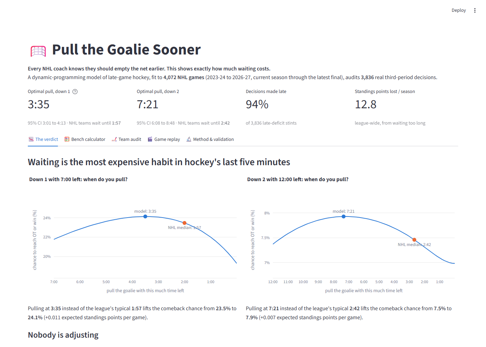

# 🥅 Pull the Goalie Sooner

**When should an NHL coach empty the net, and how much does waiting cost?**

An open-source decision model and Streamlit app, built on every regular-season play from **4,072 NHL games**: 2023-24, 2024-25 and 2025-26, plus the 2026-27 games to date. Submission for the **AQX Sports Analytics Data Bowl 4.0**.

| | Model: optimal pull (95% CI) | What NHL teams actually do (median) |
|---|---|---|
| **Down 1**, even strength | **3:35** left (3:01 to 4:13) | 1:57 |
| **Down 2**, even strength | **7:21** left (6:08 to 8:48) | 2:42 |

* **94%** of 3,836 late-deficit decisions were made late, and the habit has not moved in four seasons.
* That habit costs the league about **13 standings points every season**.
* The optimal moment depends on the roster: from about **2:40** (weak 5v5 offence) to **4:56** (elite) when down 1.



## Run it

```bash
python -m venv .venv
# Windows: .venv\Scripts\activate    macOS/Linux: source .venv/bin/activate
pip install -r requirements.txt
streamlit run app.py
```

The processed results are committed in `data/processed/`, so the app runs immediately. To rebuild from scratch, which downloads about 13 MB from the NHL API and takes a few minutes:

```bash
python scripts/fetch_data.py          # all seasons; `python scripts/fetch_data.py 2026` refreshes this season only
python scripts/build_outputs.py       # model, bootstrap, audit, calibration -> data/processed/
pip install pytest && pytest -q       # unit tests (parser + decision model)
```

## What's in the app
| Tab | What it answers |
|---|---|
| **The verdict** | Comeback chance for every possible pull time: the optimal pull vs. the league median, and the trend by season |
| **Bench calculator** | "Down 1, 3:40 left, we're on the power play: pull now?" Adjusts for team strength and OT ability |
| **Team audit** | Expected standings points lost per team-season, actual vs. team-specific optimal pull times |
| **Game replay** | Any late-deficit decision: score margin, empty-net window, goals, model vs. actual timing |
| **Method & validation** | Rates, bootstrap distributions, out-of-sample calibration, limitations |

## Method (short)
1. **Detecting pulls.** In the NHL API, each play's `situationCode` (`[away goalie][away skaters][home skaters][home goalie]`, e.g. `0651`) records whether each goalie is in net, so every empty-net second can be recovered. Delayed-penalty extra attackers are excluded using `delayed-penalty` events, with a fallback heuristic.
2. **Late-game scoring rates.** Over the last 10:00 of the third, goals are treated as Poisson processes for each state: goalie in or pulled × even / power play / shorthanded. Sparse cells use gamma shrinkage. See `src/pullgoalie/model.py`.
3. **Markov decision process.** Backward induction on a one-second grid over (time left, goal margin from −4 to +4, power-play clock from −120 to +120 s). The reward is **standings points** (win 2, OT/SO = 1 + P(win OT)). When leading, the opponent pulls at the league's observed median.
4. **Bootstrap.** 200 game-level resamples give confidence intervals on the optimal times.
5. **Audit.** For each third-period stint trailing by 1 or 2 that reaches T*, cost = V\*(decision time) − V(pull at actual time). Censored stints (a goal before any pull) use the team's typical pull time. See `src/pullgoalie/audit.py`.
6. **Calibration.** Rates are fit on 2023-25, then tested at the moment of 942 later real pulls. The Brier score (lower is better) is 0.079, against 0.085 for a constant baseline.

## Limitations
* Zone and possession at the moment of the pull are not modeled. The model under-predicts comebacks in its highest bin (actual 25% vs. predicted 15%).
* Score effects are pooled across deficits of 1 to 3 goals. Team strength uses season-level 5v5 rates, not the five players on the ice.
* Power-play and shorthanded pulled rates rest on hundreds, not thousands, of minutes, so treat those recommendations as directional.

## Repository layout
```
app.py                      Streamlit app
scripts/fetch_data.py       download + flatten NHL play-by-play
scripts/build_outputs.py    full analysis -> data/processed/
src/pullgoalie/parse.py     plays -> timed game-state intervals, strategic-pull detection
src/pullgoalie/model.py     scoring rates + dynamic program
src/pullgoalie/audit.py     decision stints, pull times, points lost, leaderboard
tests/                      unit tests
DEVPOST.md                  submission write-up
```

Data © NHL, accessed through the public statsapi endpoints for non-commercial research. Code under the MIT License.
